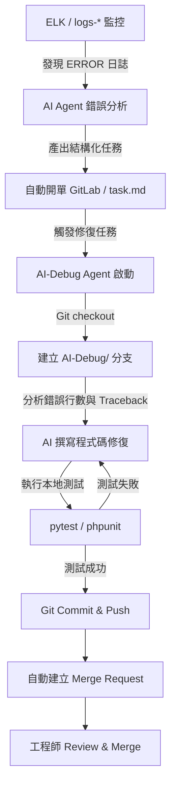

# 📝 AI-Debug 自癒系統實作藍圖 Memo (v1.0)

本 Memo 記錄了 **ELK 日誌分析 AI Agent** 升級為 **SRE 自癒系統 (Self-healing SRE)** 的漸進式實作計劃。目標是建立一個能夠「自動監控、自動開單、自動修復、自動測試並提交 PR」的閉環系統。

---

## 🎯 專案願景
透過 AI 自動化運維（AIOps），將日常的錯誤修復流程完全自動化。當系統發生真實異常時，AI Agent 能在**不需要工程師介入**的情況下，完成 bug 定位與代碼修復，並在 Git 倉庫中提交 Merge Request 供工程師複核。

---

## 📅 漸進式實作三階段

### 📍 階段一：真實日誌流轉與 AI 診斷
*   **目標**：確保系統產生真實錯誤時，ELK 管道暢通，且 AI Agent 能夠給出精準的程式碼出錯位置分析。
*   **實作步驟**：
    1.  **製造真實錯誤**：在 RAG backend API 程式碼中故意注入一行 `1/0` 或 `raise ValueError("模擬真實崩潰")`。
    2.  **觸發日誌**：執行 `python tools/rag_stimulator.py` 對該端點進行提問測試，產生 ERROR 日誌。
    3.  **分析並發信**：執行 `python main.py`，確認 Elasticsearch 成功撈取該日誌，並藉由 Gmail 收到分析報告。
*   **關鍵驗證**：郵件中必須包含明確的出錯檔案、行號（例如 `llm_client.py:120`）與錯誤堆疊。

---

### 📍 階段二：AI 自動分拆待辦清單（Todo-list / GitLab Issue）
*   **目標**：將日誌中零散的錯誤，透過 AI 轉化為可追蹤的任務卡。
*   **實作步驟**：
    1.  **格式化 LLM 輸出**：修改 `main.py` 的 prompt，要求 LLM 在發現錯誤時，額外輸出 JSON 格式的結構化任務欄位（含標題、嚴重度、檔案位置、修復邏輯建議）。
    2.  **對接任務追蹤系統**（二選一）：
        *   *輕量版*：自動修改本地專案根目錄下的 `task.md`，將 bug 填入 TODO 列表。
        *   *完整版*：呼叫 GitLab API，在專案中自動建立一筆標題為 `[AI-Bug] {error_location} {error_type}` 的 **GitLab Issue**。
*   **關鍵驗證**：每當系統報錯，專案的 Issue 看板會自動出現對應的 Bug 修復任務卡。

---

### 📍 階段三：AI-Debug 自動修復與 DevOps 整合（終極閉環）
*   **目標**：實作自動修復與測試，讓 AI 成為你的虛擬 SRE 助手。
*   **實作步驟**：
    1.  **建立 AI-Debug 模組**：開發 `ai_debugger.py` 腳本。
    2.  **Git 分支控制**：
        *   從 GitLab 讀取待辦 Issue，或讀取本地的 `task.md`。
        *   自動建立 Git 分支：`git checkout -b AI-Debug/fix-{issue_id}`。
    3.  **自動代碼修改**：AI 根據出錯的檔案與行號，讀取該檔案代碼，並使用 LLM 撰寫修復程式碼。
    4.  **自動化測試驗證**：在背景執行本地測試指令：
        *   `pytest` (Python 端) 或 `vendor/bin/phpunit` (PHP 端)。
        *   若測試失敗，將錯誤資訊丟回 LLM 進行疊代修改；若測試通過，則進行 `git commit` 與 `git push`。
    5.  **建立 Merge Request (MR)**：自動呼叫 GitLab API 建立 MR，通知你進行 Code Review。
*   **混沌工程驗證**：
    *   撰寫 `chaos_monkey.py` 腳本，隨機破壞程式碼語法 ➡️ 自動觸發 API 崩潰 ➡️ 驗證 AI-Debug 能否在背景自己修好並送出 MR。

---

## 🛠️ 近期 TODO 清單 (排程建議)
- [ ] **TODO 1**：在主專案程式中注入一個手動錯誤，執行 `python main.py` 驗證真實 Error 是否能透過 `logs-*` 索引撈到，並寄送郵件。
- [ ] **TODO 2**：修改 `main.py` 與 `.env`，加入 GitLab API Token，實作「自動開 GitLab Issue」功能。
- [ ] **TODO 3**：設計 `ai_debugger.py` 核心邏輯（Git 分支操作與代碼寫入）。
